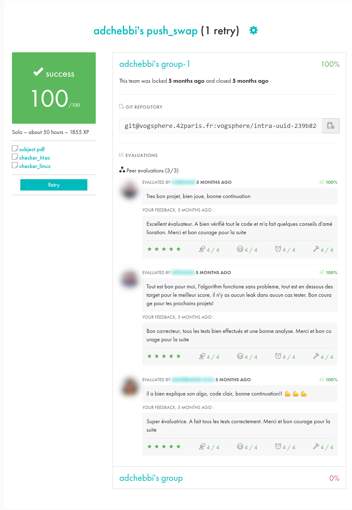

*This project has been created as part of the 42 curriculum by adchebbi.*

# push_swap

> Sort a stack of integers using only two stacks and 11 restricted operations, in as few moves as possible.
> A cost-based greedy algorithm sorts 500 numbers in about 5,100 operations.

   

```console
$ ./push_swap 3 2 1
ra
sa
$ ARG="4 67 3 87 23"; ./push_swap $ARG | ./checker_linux $ARG
OK
```

## Benchmarks

Measured on 15 random inputs per size, each output verified by an independent checker:

| Input size | Operations (min to max) | Maximum-grade target |
|---|---|---|
| 3 | 0 to 2 | ≤ 3 |
| 5 | 5 to 9 | ≤ 12 |
| 100 | **522 to 599** | < 700 |
| 500 | **4,826 to 5,355** | ≤ 5,500 |

## The rules

Two stacks, `a` (filled with the input) and `b` (empty). Allowed operations:

| Op | Effect |
|---|---|
| `sa` `sb` `ss` | swap the top 2 elements of a / b / both |
| `pa` `pb` | push the top of b onto a / the top of a onto b |
| `ra` `rb` `rr` | rotate up (first becomes last) on a / b / both |
| `rra` `rrb` `rrr` | rotate down (last becomes first) on a / b / both |

The program prints the shortest sequence it can find that leaves `a` sorted in ascending order and `b` empty.

## Algorithm

1. **Indexing**: each value is replaced by its rank (0 to n−1), which makes comparisons trivial and independent
   of the actual values.
2. **Small inputs**: 2 and 3 elements are sorted directly with at most 2 operations.
3. **Phase 1, a → b**: push everything except 3 elements to `b`, which is kept in descending order. For
   each candidate in `a`, compute the **total rotation cost** to bring it to the top of `a` *and* to its target
   slot in `b`, then move the **cheapest** one. When both stacks rotate the same way, the moves are merged into
   `rr` / `rrr`.
4. **Sort the last 3** directly in `a`.
5. **Phase 2, b → a**: push each element back to its correct position in `a`, then rotate `a` so the smallest
   element is on top.

## Build & Run

```bash
make
./push_swap 4 67 3 87 23        # separate arguments
./push_swap "4 67 3 87 23"      # or a single string
```

Count operations, or check correctness with the 42 checker:

```bash
ARG=$(shuf -i 0-100000 -n 500 | tr '\n' ' '); ./push_swap $ARG | wc -l
ARG=$(shuf -i 0-100000 -n 500 | tr '\n' ' '); ./push_swap $ARG | ./checker_linux $ARG
```

## Error handling

`Error` is printed on stderr (exit status 1) for non-integers, values outside the `int` range, duplicates and empty
strings. With no argument, or an already sorted input, nothing is printed.

## Project structure

```
.
├── Makefile
├── include/
├── libft/            # personal C library (with ft_printf and get_next_line)
└── src/
    ├── main.c
    ├── parsing/      # argument splitting, validation, overflow and duplicate checks
    ├── operations/   # swap, push, rotate, reverse rotate
    ├── sorting/      # indexing, 2-3 element sorts, targets, costs, cheapest-move execution
    └── utils/        # stack helpers
```

## Resources

- [Push_swap: a journey to find the most efficient sorting algorithm](https://medium.com/@ayogun/push-swap-c1f5d2d41e97), which describes the cost-based approach
- [push_swap visualizer](https://github.com/o-reo/push_swap_visualizer)
- [push_swap tester](https://github.com/LeoFu9487/push_swap_tester)

### AI usage

AI (Claude) was used as a learning companion to understand the cost-based sorting algorithm and the edge cases
of argument parsing. The code was written step by step with explanations at each stage, followed by a review
session to make sure every component was fully understood.

## 42 evaluation

Validated at **100/100** on the second attempt, by 3 peer evaluations.
Other students' names and photos are blurred.

<p align="center"></p>

## Author

**Adem Chebbi** ([@ademchbb](https://github.com/ademchbb)), 42 login `adchebbi`
